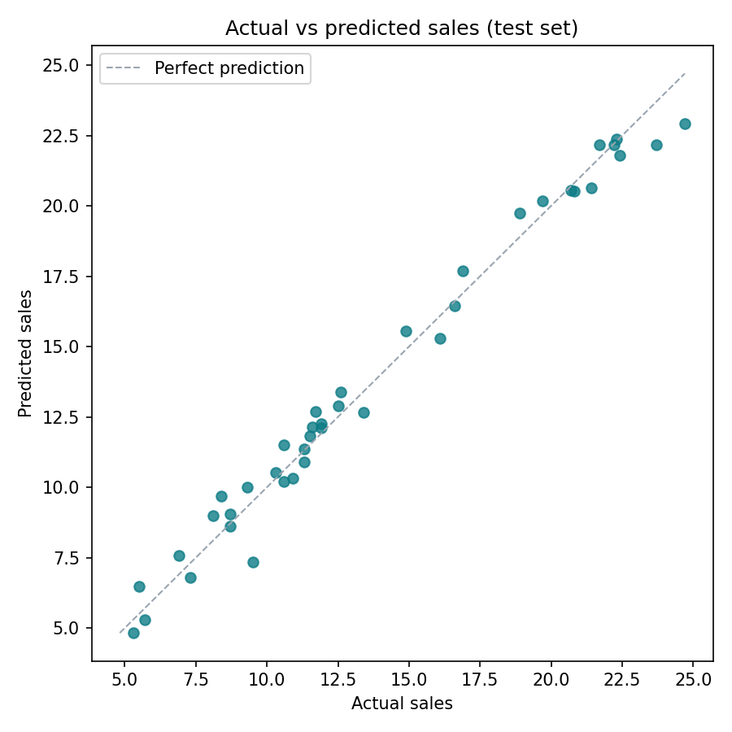
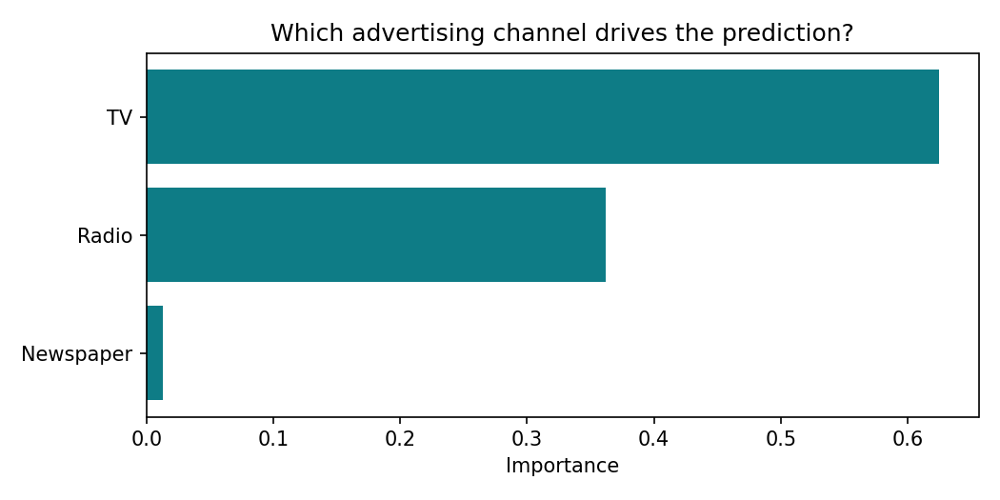
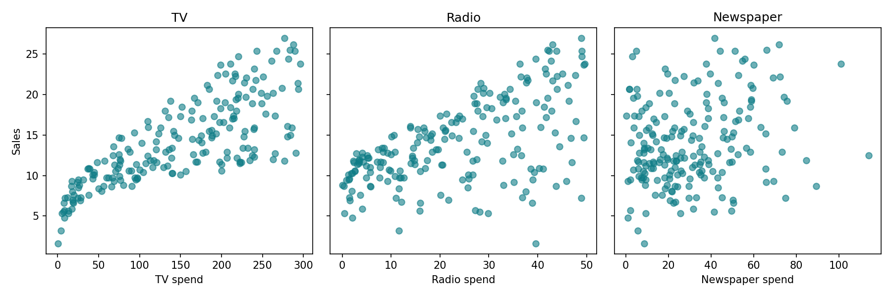

# 📊 Sales Prediction from Advertising Spend



Predict product sales from advertising spend on **TV, radio and newspaper**, and find out which channel is worth the budget. A CodeAlpha data science project.

**Portfolio:** [syedahafsa135.github.io](https://syedahafsa135.github.io)

---

## Business question

A marketing team has a fixed budget to split across TV, radio and newspaper. **How does spend on each channel relate to sales, and can we predict sales for a planned budget before spending it?**

## Data

- **Source:** the Advertising dataset, in `data/Advertising.csv`
- **Size:** 200 rows, one per market
- **Columns:** `TV`, `Radio`, `Newspaper` (advertising spend) and `Sales` (the target)

## Approach

1. Load the data and drop the unnamed index column
2. Use the three spend columns as features and `Sales` as the target
3. Split 80% for training and 20% for testing (`random_state=42`)
4. Train a **Random Forest Regressor** (100 trees)
5. Evaluate on the **test set only** with MAE, MSE, RMSE and R²
6. Save the model (`models/model.pkl`) and serve predictions in a **Streamlit** app

## Key findings

Scores on the 40 test markets (output of `python -m src.evaluate`):

| Metric (test set) | Value |
|---|---|
| MAE | 0.62 |
| MSE | 0.59 |
| RMSE | 0.77 |
| R² | 0.981 |

- **The model is accurate on unseen markets.** It explains 98.1% of the variation in sales.
- **TV matters most and newspaper barely at all.** Feature importance is TV 0.625, Radio 0.362, Newspaper 0.013.
- **The raw data agrees.** Sales rise clearly with TV spend and more loosely with radio spend, with no clear pattern for newspaper.
- **Recommendation:** prioritise TV, then radio. Newspaper is the first candidate for cuts. These are relationships rather than proof of cause, so test any budget shift in a few markets first.





## How to run

**Option A: Google Colab (nothing to install)**

```python
!git clone https://github.com/syedahafsa135/CodeAlpha_SalesPrediction.git
%cd CodeAlpha_SalesPrediction
!python -m src.train      # trains the model and prints test-set scores
!python -m src.evaluate   # prints scores + feature importance, saves charts to images/
```

**Option B: on your own computer**

```bash
git clone https://github.com/syedahafsa135/CodeAlpha_SalesPrediction.git
cd CodeAlpha_SalesPrediction
python -m venv venv
venv\Scripts\activate          # on Mac/Linux: source venv/bin/activate
pip install -r requirements.txt
python -m src.train
python -m src.evaluate
streamlit run app.py           # opens the prediction app in your browser
```

## Project structure

```
├── app.py              # Streamlit app: train, predict, about
├── data/Advertising.csv
├── models/model.pkl    # saved Random Forest model
├── images/             # charts created by src/evaluate.py
└── src/
    ├── data.py         # load data and split train/test
    ├── train.py        # train, save and score the model
    ├── evaluate.py     # test-set scores, feature importance, charts
    └── predict.py      # predict sales for a new budget
```

## Tech stack

Python · pandas · NumPy · scikit-learn · joblib · Matplotlib · Streamlit
